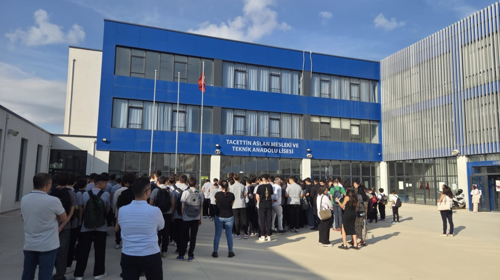

# kod_asistanim
# Projenin Adı: Kod-Asistanım v0.1
## Projenin Amacı: Kullanıcılara günlük işlerinde (hesaplama, selamlama vb.) yardımcı olacak bir dijital asistan tasarlamak
## Projenin Hedefleri: Bu asistanın ilerleyen zamanlarda hangi özellikleri kazanacağını(örneğin v1.0 Akıllı Menü, v2.0 Veri Saklama) maddeler hâlinde yazınız.
`print("Merhaba 9C Sınıfı")`
```
Adım1. Başla
Adım2. sayi1 gir
Adım3. sayi2 gir
Adım4. toplam=sayi1+sayi2
Adım5. toplam yaz
Adım6. Bitir
```



